# Expense Tracker

A full-stack expense tracker built with React, TypeScript and Vite on the frontend, a .NET 10 minimal API on the backend, and SQLite with EF Core for storage (MongoDB Atlas is planned; see ADR 0001). It supports light, dark and system themes.

## Features

- **Dashboard**: a month picker, totals with a comparison against the previous month, spending by category (donut chart), a 6-month trend (bar chart), **budget progress** and recent expenses. It updates live.
- **Families**: each family has its own expenses, categories and budgets, and people only see their own family's data. Roles are **Owner** (manages members, invites, categories and budgets), **Member** (adds and edits their own expenses) and **Viewer** (read only). Owners add members directly or share a **48-hour, single-use invite link**. Mark an expense **Private** and only you see it, even the Owner. Family roles are separate from the app-wide roles (see [Signing in & access control](#signing-in--access-control)).
- **Expenses grid**: server-side **paging, sorting and filtering** (date range, category, member, search). Grid state lives in the URL, so views are shareable and survive reloads.
  - **Inline editing:** double-click a row or use the pencil; **Enter** saves and **Esc** cancels.
  - **Row selection** (it persists across pages) with **bulk delete**.
  - **CSV export** of the current filter and sort.
  - Every delete asks for **confirmation** first, then offers **Undo**.
- **Categories grid**: paged, sortable and searchable, with inline editing of name, color and **monthly budget**. A category that still has expenses can't be deleted.
- **Budgets**: an optional monthly limit per category. The dashboard shows each budget as on track, close to the limit (80% or more) or over budget. When an expense pushes a category over its limit, every open session gets an alert.
- **Realtime (SignalR)**: changes made in one tab or by one user appear everywhere else immediately, with a notification. The header shows the live connection state and how many sessions are online. The client reconnects automatically and refreshes whatever it might have missed.
- **Open on your phone**: the **Open on your phone** button under the sign-in form shows a large QR code of the sign-in page, with the app logo in the centre. Scan it with a phone camera to open the app there and sign in as usual. The code is always dark on white, in both themes, so cameras read it reliably.
- **Themes**: Light, Dark or System. The choice is saved in `localStorage`. System mode follows OS changes live, and the saved theme is applied before first paint, so there's no flash of the wrong theme. Switching themes plays a circular reveal from the toggle (View Transitions API).
- **UI**: an animated gradient-mesh background with frosted-glass surfaces, spring-animated modals (a bottom sheet on phones) with exit animations, staggered entrances, and count-up numbers. All motion respects `prefers-reduced-motion`.
- **Notifications**: success, info, warning and error toasts. They auto-dismiss (pausing on hover), stack above open modals, and offer **Undo** after deleting an expense.
- **Observability**: OpenTelemetry logs, traces and metrics from the API and from the browser, viewed together in the Aspire dashboard during development.

## Prerequisites

- .NET 10 SDK
- Node.js 20+
- No database install is needed: the API uses a SQLite file that it creates on first run.

## Running locally

### Option A: Aspire (recommended for development)

One command starts the API and the client in **Development** and opens the Aspire dashboard:

```powershell
dotnet run --project src/ExpenseTracker.AppHost
```

If you have the Aspire CLI installed, `aspire run` from the repository root does the same thing.

| What | URL |
| --- | --- |
| Aspire dashboard (resources, console logs, structured logs, traces, metrics) | https://localhost:17010 (use the login link printed in the console) |
| App | http://localhost:5010 |
| API, and Scalar API docs | http://localhost:7010, http://localhost:7010/scalar |

The AppHost (`src/ExpenseTracker.AppHost`) is for **development only**: it refuses to run in publish mode. Staging and Production run the API and client on their own (Option B and [Environments](#environments--configuration)).

### Option B: separately (any environment)

```powershell
# Terminal 1 – API (Development)
cd src\ExpenseTracker.Api
dotnet run --launch-profile http

# Terminal 2 – client (development)
cd src\web\expense-tracker-web
npm install
npm run dev
```

Then open http://localhost:5010. The Vite dev server proxies `/api` requests to the API on port 7010. In Development, the API applies EF Core migrations on startup, which creates the SQLite database at `src/ExpenseTracker.Api/App_Data/expense-tracker.db`. Each new family gets the default categories when it is created. To start again from an empty database, stop the API and delete the `App_Data` folder.

#### Open it on your phone (same Wi-Fi)

`localhost` only works on your PC, so give the QR code your PC's network address and let Vite listen on the network:

1. Find your PC's address: `ipconfig` → "IPv4 Address", for example `192.168.1.20`.
2. Create `src/web/expense-tracker-web/configs/.env.development.local` (git-ignored) with `VITE_PUBLIC_URL=http://192.168.1.20:5010`.
3. Start the API as above, then the client with `npm run dev -- --host`. Allow Node.js through Windows Firewall on private networks if asked.
4. Open http://localhost:5010, select the QR icon on the sign-in card, and scan it with your phone.

The phone talks only to Vite, which proxies `/api` and `/hubs` to the API, so no CORS change is needed. Aspire (option A) doesn't start Vite with `--host`, so its QR code shows a `localhost` address (the dialog says so); use option B for phone testing.

> If PowerShell reports that `npm.ps1` is not digitally signed, use `npm.cmd run dev` instead, or run
> `Set-ExecutionPolicy -Scope CurrentUser RemoteSigned` once.

## Signing in & access control

Every API endpoint requires authentication (except sign-in, health and, in Development, the API docs). In Development the API seeds these accounts, and the login page offers them as one-click demo buttons:

| Account | Password | Role | Can |
| --- | --- | --- | --- |
| `superadmin@expensetracker.local` | `SuperAdmin123` | SuperAdmin | Everything, including managing other admins |
| `admin@expensetracker.local` | `Password123` | Admin | Users and Reader/User role permissions, plus all data |
| `user@expensetracker.local` | `Password123` | User | Add, edit, delete and export expenses and categories |
| `reader@expensetracker.local` | `Password123` | Reader | Read and export only |

In Development the API also seeds two demo families, so you can see that families never see each other's data:

| Family | Members (family role) |
| --- | --- |
| Sharma family | `user@` (Owner), `admin@` (Member), `reader@` (Viewer), all on `@expensetracker.local` |
| Verma family | `verma.owner@` (Owner), `verma.member@` (Member), same domain and `Password123` |

`superadmin@` has no family: it manages users app-wide but sees no expenses until it creates or joins one. Family roles are separate from the app roles above: the app role decides whether you may use expenses at all, the family role decides whose data you see and what you may do in it (Owner manages members, invites, categories and budgets; Member adds and edits their own expenses; Viewer reads). Mark an expense **Private** and only you see it. Owners add members or create a 48-hour, single-use invite link on the **Family** page.

- **Browser:** sign in at `/login`; sign out from the avatar menu (`/logout`). Manage your password and API keys at `/account`, and users, roles and claims at `/admin` (Admin or above).
- **Scripts:** create a personal API key on the account page (or `POST /api/v1/auth/api-keys`) and send it as `x-api-key`. Keys expire and can be limited to specific permissions.
- **Scalar/OpenAPI:** call `POST /api/v1/auth/login`, then paste the `accessToken` into the Bearer auth.

Outside Development, set these through environment variables or a secret store (never committed files): `Authentication__Jwt__SigningKey` (32+ characters, required to start), and `Identity__Seed__AdminEmail` / `Identity__Seed__AdminPassword` to bootstrap the first SuperAdmin. See [docs/architecture.md](docs/architecture.md#security-authentication--rbac) for the design.

## Observability (OpenTelemetry)

Under Aspire, everything shows up in one dashboard, from the browser to the database:

| Source | Logs | Traces | Metrics |
| --- | --- | --- | --- |
| **React client** (`client`) | Startup, navigation, theme changes, every toast, API warnings and errors, unhandled errors and React render errors (with stack traces) | Page load, clicks and submits, one span per API call, and the underlying `fetch` | – |
| **API** (`api`) | ASP.NET Core and app logs, including business events from source-generated `LoggerMessage`s (created, updated or deleted expenses and categories, rejected requests, conflicts) | Incoming requests and SQL commands | ASP.NET Core, HTTP client and .NET runtime |

**End-to-end traces.** The browser's fetch instrumentation sends a W3C `traceparent` header with each API call. As a result, a single trace contains the click, the client's API span, the HTTP request, the API's request span and its SQL spans. Logs on both sides carry the trace ID, so in **Structured logs** you can open any log line's trace, or filter a trace's logs.

**How it's wired:**

- **Backend:** `src/ExpenseTracker.ServiceDefaults` (the standard Aspire service defaults) adds OpenTelemetry logging, tracing and metrics, health checks (`/health`, `/alive`, Development only), service discovery and HTTP resilience. The API adds SqlClient tracing and a database health check. Telemetry is exported over OTLP only when `OTEL_EXPORTER_OTLP_ENDPOINT` is set, which Aspire does for you.
- **Browser:** `src/web/expense-tracker-web/src/shared/telemetry/` uses the official OpenTelemetry JS Web SDK, exporting OTLP/HTTP (protobuf) to the dashboard:
  - `otel.ts` sets up the tracer and logger providers, plus fetch, document-load and user-interaction instrumentation. It's lazy-loaded, so it only ships when telemetry is enabled.
  - `logger.ts` is a structured logger that emits OpenTelemetry log records using semantic-convention attributes such as `exception.*`, `http.*` and `url.*`, and mirrors them to the console.
  - The AppHost injects the standard `OTEL_*` variables (endpoint, API key header, service name) into the Vite process, and `vite.config.ts` hands them to the bundle.
  - The dashboard's OTLP/HTTP endpoint (`:19011`) allows CORS from `http://localhost:5010`; see `src/ExpenseTracker.AppHost/Properties/launchSettings.json`.
- **Outside Aspire:** browser telemetry is off and logs go to the console only (warnings and errors in production builds). To ship telemetry from Staging or Production, point the client at an OpenTelemetry Collector with `VITE_OTEL_EXPORTER_OTLP_ENDPOINT` (and, optionally, `VITE_OTEL_EXPORTER_OTLP_HEADERS`) in `configs/.env.<mode>`, and set `OTEL_EXPORTER_OTLP_ENDPOINT` for the API.

### Logging conventions

**Backend:**
- **Structured logging:** all application logs use source-generated `[LoggerMessage]` methods with named placeholders, which give structured fields rather than string concatenation.
- **Stable event IDs:** every log has an event ID from `Common/LogEvents.cs`, so it can be filtered or alerted on independently of the wording:

  | Range | Area |
  | --- | --- |
  | 1xxx | Expenses |
  | 2xxx | Categories |
  | 3xxx | Budgets (3001 means over budget) |
  | 4xxx | Realtime |
  | 5xxx | HTTP and platform |

- **One request log per call:** `HTTP {HttpMethod} {HttpRoute} responded {StatusCode} in {ElapsedMs} ms`. It uses the route template (low cardinality), and its level follows the status: Information below 400, Warning for 4xx, Error for 5xx.
- **Validation failures** are logged once, centrally, with the field names and messages.
- **Business events** record what changed. For example, `Updated expense 42: amount 250 → 300, category 1 → 3`, and `Category 6 'Health' exceeded its monthly budget for 2026-10: spent 150 of 100`.
- **Startup** logs the effective configuration and the migrations it applied.
- **Levels:** reads (list, summary, budget status) log at **Debug**, which is enabled for `ExpenseTracker` in Development. Writes log at Information, expected rejections at Warning, and failures at Error.
- **No PII:** logs carry IDs, amounts, dates and category names, never free-text descriptions, notes or search terms.
- **Scope:** each request opens a logging scope with `ClientId` (from `X-Client-Id`). With OpenTelemetry, every log also carries the trace ID.

**Browser:**
- **Named events:** `logger.event('expense.updated', …)` emits an OpenTelemetry log record with an `event.name` and semantic-convention attributes. Events include:
  - App and navigation: `app.started`, `app.navigated`, `app.theme_changed`
  - Expenses: `expense.created`, `expense.updated`, `expense.deleted`, `expense.restored`, `expenses.bulk_deleted`, `expenses.exported`, `expenses.filters_changed`
  - Inline editing: `expense.inline_edit_started`, `expense.inline_edit_cancelled`, `expense.validation_failed`
  - Grid: `grid.sorted`, `grid.page_changed`
  - Categories: `category.*`
  - Budgets and realtime: `budget.exceeded_notified`, `realtime.connected`, `realtime.reconnecting`, `realtime.reconnected`, `realtime.disconnected`, `realtime.connect_failed`
  - Browser: `browser.web_vital` (LCP, INP, CLS, FCP, TTFB), `browser.online`, `browser.offline`
- **Errors are logged with context:** API warnings and errors include status and problem details, slow API calls (over 1.5 s) log a warning, and unhandled errors and React render errors are logged with stack traces.
- **Correlation:** API call logs are bound to the call's span, so they link to the same trace as the server logs. The resource carries `session.id`, which equals the `X-Client-Id` the server logs.
- **No PII:** the browser applies the same rule. Toast logs carry the title only, and URLs are logged without query strings.

## Environments & configuration

Settings live in a `configs/` folder on each side. Each client mode pairs with the server environment of the same name.

| Environment | Server (`src/ExpenseTracker.Api`) | Client (`src/web/expense-tracker-web`) | Client port → API port | Database (local) | API docs |
| --- | --- | --- | --- | --- | --- |
| **Development** | `dotnet run --launch-profile http`, or all-in-one via Aspire | `npm run dev` | 5010 → 7010 | `ExpenseTracker` | ✅ `/scalar` |
| **Staging** | `dotnet run --launch-profile staging` | `npm run dev:staging`, or `build:staging` + `preview:staging` | 5020 → 7020 | `ExpenseTracker_Staging` | ✅ `/scalar` |
| **Production** | `dotnet run --launch-profile production` | `npm run build` + `npm run preview` | 5030 → 7030 | `ExpenseTracker_Production` | ❌ off |

Ports follow one scheme: the client is `50x0` and the API is `70x0`, where x is 1 for Development, 2 for Staging and 3 for Production. The API's `https` profile adds 7011. Each pair uses its own ports, so you can run them side by side. The client shows a **Dev** or **Staging** badge next to the logo; production shows none.

### Server: `src/ExpenseTracker.Api/configs/`

| File | Purpose |
| --- | --- |
| `appsettings.json` | Shared defaults (required). Safe values: no connection string, docs off, auto-migrate off. |
| `appsettings.Development.json` | SQLite file `App_Data/expense-tracker.db`, CORS for `:5010`, Scalar on, auto-migrate on, EF SQL command logs muted (SQL appears in traces instead). |
| `appsettings.Staging.json` | SQLite file `App_Data/expense-tracker.staging.db`, CORS for `:5020` and the staging domain, Scalar on. |
| `appsettings.Production.json` | No connection string in source control, docs off, CORS for the production domain, quieter logging. |

`UseConfigsFolder()` (`Common/ConfigurationExtensions.cs`) points ASP.NET Core's standard appsettings sources at this folder without changing precedence. Later sources still win: user secrets (Development), then environment variables (for example `ConnectionStrings__DefaultConnection`), then command-line arguments. The environment comes from `ASPNETCORE_ENVIRONMENT`, which each launch profile sets.

Settings:

- `ConnectionStrings:DefaultConnection`: a SQLite connection string such as `Data Source=App_Data/expense-tracker.db`. A relative path is resolved against the API project folder, and the folder is created if needed. If this is missing, startup fails with a message naming the file or environment variable to set.
- `Cors:AllowedOrigins`: browser origins allowed to call the API directly.
- `Features:ApiDocs`: serves `/openapi/v1.json` and `/scalar`.
- `Features:MigrateDatabaseOnStartup`: applies EF Core migrations when the app starts.

The local `production` launch profile supplies its connection string through an environment variable, so `appsettings.Production.json` never holds one.

### Client: `src/web/expense-tracker-web/configs/`

| File | Purpose |
| --- | --- |
| `.env` | Shared by all modes (`VITE_API_BASE_URL=/api/v1`). |
| `.env.development` / `.env.staging` / `.env.production` | Per-mode settings (see below). |
| `.env.local`, `.env.<mode>.local` | Your machine-only overrides (git-ignored). |

Variables:

- `CLIENT_PORT`: the dev/preview server port. The server's `Cors:AllowedOrigins` for that environment must include it.
- `API_PROXY_TARGET`: the API that `/api` is forwarded to, which is the matching server launch profile.
- `VITE_ENV_LABEL`: the badge text.
- `VITE_PUBLIC_URL` (optional): the address other devices use to reach the app, encoded in the sign-in QR code. Empty means the address in the browser's bar. See "Open it on your phone".
- `VITE_API_BASE_URL`: the base URL the browser calls. Keep `/api/v1` when the client and API share an origin (or go through the proxy). Use an absolute URL when they're deployed on different domains.
- `VITE_OTEL_EXPORTER_OTLP_ENDPOINT` / `VITE_OTEL_EXPORTER_OTLP_HEADERS` (optional): browser telemetry outside Aspire. Under Aspire these come from `OTEL_*`.

Only `VITE_*` variables reach the browser bundle. `CLIENT_PORT` and `API_PROXY_TARGET` are read by `vite.config.ts` only. Real environment variables override the files; that's how Aspire sets `API_PROXY_TARGET` and the OTLP settings. Staging builds go to `dist-staging/`, production builds to `dist/`.

### Other settings

| What | Where |
| --- | --- |
| Currency and locale | `src/web/expense-tracker-web/src/shared/config/env.ts` (default `INR` / `en-IN`) |
| Theme colors | `src/web/expense-tracker-web/src/app/styles/tokens.css` |

## Database migrations

`dotnet-ef` is installed as a local tool, so run `dotnet tool restore` once first.

```powershell
dotnet ef migrations add <Name> --project src/ExpenseTracker.Infrastructure --startup-project src/ExpenseTracker.Api
dotnet ef database update --project src/ExpenseTracker.Infrastructure --startup-project src/ExpenseTracker.Api
```

## API

Every REST route is versioned under `/api/v1` (`Endpoints/ApiRoutes.cs`, ADR 0006). The SignalR hub (`/hubs/expenses`) and the health checks are not versioned.

| Method | Route | Notes |
| --- | --- | --- |
| GET | `/api/v1/expenses` | **Paged.** Query: `from`, `to` (YYYY-MM-DD), `categoryId`, `memberId` (default: everyone), `search`, `page`, `pageSize` (≤ 100), `sortBy` (`date`, `amount`, `description`, `category`, `createdAt`), `sortDir`. Returns `items`, `page`, `pageSize`, `totalCount`, `totalPages` and `totalAmount` |
| GET | `/api/v1/expenses/export` | CSV with the same filters and sort, up to 10,000 rows (formula-injection safe, UTF-8 BOM) |
| GET | `/api/v1/expenses/summary` | Query: `from`, `to`, `memberId`. Returns totals by category and by month |
| POST | `/api/v1/expenses/bulk-delete` | Body: `{ "ids": [..] }` (max 500). Returns `deleted` and `deletedIds` |
| GET/PUT/DELETE | `/api/v1/expenses/{id}` | |
| POST | `/api/v1/expenses` | Body includes the optional `isPrivate` (only the creator sees a private expense) |
| GET | `/api/v1/categories` | **Paged.** Query: `search`, `page`, `pageSize`, `sortBy` (`name`, `expenses`, `budget`), `sortDir` |
| GET | `/api/v1/categories/lookup` | Every category (`id`, `name`, `color`) for dropdowns |
| POST | `/api/v1/categories` | Body includes the optional `monthlyBudget` |
| PUT/DELETE | `/api/v1/categories/{id}` | DELETE returns 409 if the category has expenses |
| GET | `/api/v1/budgets` | Query: `year`, `month` (default: current month). Budget status per category |
| GET | `/api/v1/families/mine` | My family with its members and (for owners) open invites. `403` when I have no family yet |
| POST | `/api/v1/families` | Create my family; I become its Owner and it gets the default categories |
| PUT | `/api/v1/families/mine` | Rename the family (Owner) |
| POST | `/api/v1/families/members` | Create an account and add it to the family (Owner) |
| PUT/DELETE | `/api/v1/families/members/{userId}[/role]` | Change a role or remove a member (Owner). The last Owner can't be demoted or removed |
| POST | `/api/v1/families/leave` | Leave my family |
| POST | `/api/v1/families/invites` | Create an invite token, shown once (Owner). Valid for 48 hours and one use |
| DELETE | `/api/v1/families/invites/{id}` | Revoke an invite (Owner) |
| POST | `/api/v1/families/invites/join` | A signed-in user without a family joins with an invite token |
| POST | `/api/v1/families/invites/accept` | **Anonymous, rate-limited.** Creates the account from an invite and joins the family |
| WS | `/hubs/expenses` | SignalR hub (see below) |

Unknown sort fields, invalid ranges and out-of-range page sizes return `400` validation problems. A page past the end is clamped to the last page. Another family's ids return `404`, never `403`, so their existence isn't revealed. A signed-in user without a family sees empty lists and gets `403` when adding data.

### Realtime (SignalR)

The hub is push-only: all writes go through the REST API, which keeps validation, logging and error handling in one place. After a successful change, the API broadcasts one of these events. Each connection joins its family's group, so events reach only the people in the same family (a person without a family gets none):

| Event | Payload | Sent when |
| --- | --- | --- |
| `ExpensesChanged` | `{ action, ids, originClientId }` | An expense is created, updated or deleted (including bulk deletes) |
| `CategoriesChanged` | `{ action, ids, originClientId }` | A category is created, updated or deleted |
| `BudgetExceeded` | `{ categoryId, categoryName, budget, spent, year, month }` | An expense pushes a category over its monthly budget (only when it crosses the limit) |
| `PresenceChanged` | `{ online }` | A session connects or disconnects |

Clients refetch what they display rather than patching local state. Each browser tab has a random **client ID**, sent as the `X-Client-Id` header and the hub's `clientId` query parameter. A tab uses it to ignore the echo of its own changes, and the server uses it to tag its logs. In development, Vite proxies `/hubs` (including WebSockets) to the API.

There are sample requests in `src/ExpenseTracker.Api/ExpenseTracker.Api.http`.

## Architecture



| Diagram | Shows |
| --- | --- |
| [Context](docs/diagrams/context.svg) | Who uses the system (family members, invited people, API-key scripts) and what it talks to (the Aspire dashboard in development). |
| [Containers](docs/diagrams/containers.svg) | The SPA, the API with its SignalR hub, Identity and family layer, the in-memory cache and the SQLite database. |
| [Sign-in](docs/diagrams/sequence-login.svg) | Login, the in-memory access token, and the rotating refresh cookie. |
| [Add an expense](docs/diagrams/sequence-add-expense.svg) | The family lookup and role check, validation, saving, the budget check, and live updates and alerts to the family over SignalR. |
| [Invite and join](docs/diagrams/sequence-invite.svg) | An Owner creates an invite link, and the invited person creates an account and joins the family. |
| [Family invite lifecycle](docs/diagrams/state-family-invite.svg) | An invite is open, then accepted, revoked or expired. |
| [Azure deployment](docs/diagrams/deployment-azure.png) | **Placeholder** until the Stage 2 Terraform exists; shows the intended shape only. |

Sources are in [docs/diagrams/](docs/diagrams/README.md); re-render them with `pwsh -File scripts/render-diagrams.ps1`.

See **[docs/architecture.md](docs/architecture.md)** for the full picture. In short:

- **Backend: Clean Architecture.** `Domain` (entities + rules, no dependencies) ← `Application` (use cases + ports) ← `Infrastructure` (EF Core adapters) ← `Api` (minimal APIs, SignalR, composition root).
  - Implementations are `internal` behind interfaces.
  - Reads and writes are split (CQRS-style).
  - Expected errors are values mapped to RFC 9457 problem details.
  - **Family access is a separate layer** on top of the app roles: a per-request family lookup, EF Core query filters and `FamilyPolicy` (ADR 0007).
  - Architecture tests enforce the dependency rule and that every family-owned entity has its family filter.
- **Frontend: MVVM-style React.**
  - Each screen is a **View** (page + presentational components) bound to a **ViewModel hook** (`useExpensesViewModel`) that holds state and commands.
  - **Models** are typed API services and validation.
  - Server state lives in **TanStack Query**, which SignalR events invalidate.
  - Dependencies are resolved through a small **typed DI container** wired only in `src/app/services.ts`.
  - Code is organised by feature (`app` → `features` → `shared`), and lint enforces those boundaries.

## Testing

```powershell
# .NET: domain, application (with fakes), architecture rules, and API integration tests
dotnet test

# Web: model, components and view-models (Vitest + Testing Library)
cd src\web\expense-tracker-web
npm test          # or: npm run check  (type-check + lint + tests)
```

The integration tests include two-family isolation checks (one family gets `404` or empty results for the other's expenses and categories, private expenses stay private, roles are enforced). The API integration tests host the real API in memory against a **throwaway SQLite file** per test class (`%TEMP%/expense-tracker-tests-<guid>.db`), which is created by migrations and deleted at the end. No Docker or database install is needed, so CI runs them on Linux. Your development database is never touched.

## Repository layout

```
ExpenseTracker.slnx               Solution (src/ + tests/ folders)
Directory.Build.props             Shared .NET settings (net10.0, nullable, latest analyzers; warnings reported, not fatal)
Directory.Packages.props          Central NuGet versions
global.json                       SDK pin + Microsoft Testing Platform
.editorconfig                     Code style
aspire.config.json                Points the Aspire CLI at the AppHost
docs/architecture.md              Layers, dependency rules, MVVM mapping
src/
  ExpenseTracker.Domain/          Entities, business rules, Result/Error
  ExpenseTracker.Application/     Use cases, ports (interfaces), DTOs, paging, log event ids
  ExpenseTracker.Infrastructure/  EF Core DbContext, configurations, migrations, repositories, queries
  ExpenseTracker.Api/             Endpoints, contracts, middleware, SignalR, configs/, composition root
  ExpenseTracker.ServiceDefaults/ OpenTelemetry, health checks, resilience
  ExpenseTracker.AppHost/         Aspire (development only)
  web/expense-tracker-web/       React app
    configs/                      Vite .env files per mode
    src/app/                      Composition root: providers, DI wiring, query client, routes, layout, styles
    src/features/<feature>/       api/ · model/ · viewModels/ · components/ · pages/ · index.ts
    src/shared/                   http client, DI, UI kit, hooks, realtime, telemetry, theme, toasts
tests/
  ExpenseTracker.Domain.Tests/
  ExpenseTracker.Application.Tests/
  ExpenseTracker.ArchitectureTests/
  ExpenseTracker.Api.IntegrationTests/
```
